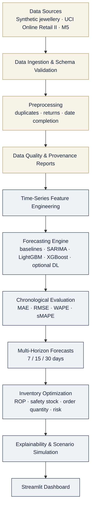

# JewelCast AI — Retail Demand Forecasting & Inventory Optimization

JewelCast AI is an AI-powered retail analytics platform for fashion jewellery. It
builds SKU-level daily demand datasets from three explicitly separated sources,
prepares them for multi-horizon forecasting, and will convert forecasts into
inventory recommendations through an interactive Streamlit dashboard.

> **Status: Milestone M0–M2 complete.** Data ingestion, validation, synthetic data
> generation, quality reporting, exploratory data analysis and the test suite are
> implemented. Forecasting, inventory optimization, explainability and the
> dashboard are planned for later milestones and are clearly labelled below.

---

## Project Overview

Fashion jewellery retailers must decide how much of each SKU to buy, when to
replenish, and how festivals and promotions will change demand. JewelCast AI
addresses this with a modular, CPU-first pipeline:

- reproducible SKU-day datasets from real public benchmarks and a synthetic
  jewellery business simulation;
- leakage-safe time-series features and chronological evaluation;
- multi-horizon forecasts for 7, 15 and 30 days;
- inventory decisions (reorder points, safety stock, order quantities, risk);
- explainable model outputs and scenario simulation;
- a premium analytics dashboard for business users.

The project is designed as a final-year B.Tech AI & Data Science major project and
as a portfolio-quality data-science application.

## Business Problem

Retail jewellery teams face four recurring problems:

1. **Overstocking** ties up working capital and increases markdown risk.
2. **Stockouts** lose sales and damage customer trust, especially during festivals.
3. **Seasonality and festivals** (Diwali, Dhanteras, Raksha Bandhan, Valentine's
   Day, wedding season) create sharp demand peaks that simple averages miss.
4. **New products** have little or no sales history, making cold-start forecasting
   difficult.
5. **Pricing and discounts** change demand in ways that are hard to anticipate.

JewelCast AI is structured to answer: which products will sell, how many units are
expected, which SKUs risk stockout or overstock, and when to reorder.

## Project Objectives

- Build validated SKU-level daily sales datasets from multiple sources.
- Engineer leakage-safe historical, calendar and commercial features.
- Train and compare baseline, statistical and machine-learning forecasters.
- Generate 7-, 15- and 30-day forecasts at SKU, category and business level.
- Evaluate with chronological backtesting using MAE, RMSE, WAPE and sMAPE.
- Convert forecasts into reorder points, safety stock and order quantities.
- Identify stockout and overstock risk.
- Explain predictions with SHAP and business-language narratives.
- Provide a reproducible Streamlit dashboard and CSV exports.

## Key Features

### Implemented (M0–M2)

- **Three data modes** with explicit provenance: synthetic jewellery, UCI Online
  Retail II, and a memory-bounded M5 subset.
- **Synthetic jewellery generator** with 8 categories, Indian festival calendar,
  promotions, price elasticity, lifecycle effects, inventory snapshots and
  purchase orders. Fully reproducible from a fixed seed.
- **UCI loader** with cancellation/return/duplicate handling, a retained
  transaction-level audit trail, transparent keyword-based jewellery
  classification, and SKU-count validation.
- **M5 loader** that selects a stratified item-store subset before melting the
  wide matrix, joins calendar and weekly prices, and preserves item/store
  hierarchies.
- **Unified daily schema** with nullable optional fields and correct null-inventory
  semantics (unknown ≠ zero).
- **Date completion** with `date_imputed` flags, forward-filled prices and
  preserved inventory nulls.
- **Data-quality reports** covering missing values, duplicates, returns,
  cancellations, SKU coverage, date coverage, zero-sales share, intermittent
  demand and flagged (not deleted) outliers.
- **Dataset metadata** with SHA-256 hashes, sizes, row counts, sheet names,
  schemas and provenance.
- **Automated pytest suite** for all three modes, provenance, null inventory,
  date filling, duplicate handling and EDA calculations.
- **Per-mode EDA pipeline** with demand trends, SKU ABC analysis, Syntetos-Boylan
  intermittent-demand classes, concentration (Gini/HHI), category and seasonality
  profiles, calendar-event uplifts, pricing/promotion associations, and synthetic
  inventory metrics.
- **EDA artefacts** per mode: `summary.json`, `EDA_REPORT.md`, CSV tables and
  Matplotlib PNG plus Plotly HTML charts under `reports/eda/<mode>/`.
- **UCI non-product audit rows** (postage, manual, bad debt, fees) are excluded
  from product EDA by default and remain available for audit.

### Planned / In Development

| Feature | Status |
|---|---|
| Time-series feature engineering | Planned (M3) |
| Baseline, SARIMA, LightGBM, XGBoost models | Planned (M4) |
| Optional LSTM/GRU extension | Planned (M4) |
| Rolling-origin backtesting and model comparison | Planned (M4) |
| Inventory optimization engine | Planned (M5) |
| Cold-start forecasting | Planned (M6) |
| SHAP explainability and narratives | Planned (M6) |
| What-if scenario simulator | Planned (M6) |
| Streamlit dashboard (6 pages) | Planned (M7) |

## System Architecture



## Dataset Information

### 1. UCI Online Retail II (real, UK, GBP)

- **Source:** <https://archive.ics.uci.edu/dataset/502/online+retail+ii>
- **File:** `online_retail_II.xlsx` (sheets `Year 2009-2010`, `Year 2010-2011`)
- **Columns:** `Invoice`, `StockCode`, `Description`, `Quantity`, `InvoiceDate`,
  `Price`, `Customer ID`, `Country` (the loader also accepts the
  `InvoiceNo`/`UnitPrice`/`CustomerID` naming variant).
- **Intended use:** real transaction benchmark for cleaning, aggregation and
  jewellery keyword classification.
- **Limitations:** UK online-retail transactions in **GBP**; **not Indian retail
  data** and **not jewellery-only**. No inventory records, so lost demand cannot
  be identified. Historical 2009–2011 period.
- **Current build:** 1,067,371 raw rows → 2,292,587 SKU-day rows, 4,916 SKUs, 357
  jewellery SKUs (validated above the 20-SKU minimum), 2009-12-01 → 2011-12-09.

### 2. M5 Forecasting Accuracy (real, Walmart benchmark, USD)

- **Source:** <https://www.kaggle.com/competitions/m5-forecasting-accuracy/data>
- **Files:** `sales_train_validation.csv`, `calendar.csv`, `sell_prices.csv`
  (optional `sales_train_evaluation.csv`, `sample_submission.csv`).
- **Intended use:** separate large-scale retail benchmark with item/store
  hierarchies, calendar events and weekly prices.
- **Limitations:** **Walmart benchmark, not jewellery data and not Voylla data.**
  No store inventory. Only a configurable subset is processed.
- **Current build:** 30 items × 3 stores (one store per state), 730 days →
  65,700 SKU-day rows, 3 categories, 2014-04-26 → 2016-04-24.

### 3. Synthetic Indian Fashion-Jewellery Dataset (simulated, INR)

- **Source:** generated locally by `src/data/synthetic.py`.
- **Categories:** Earrings, Necklaces, Rings, Bracelets, Bangles, Anklets,
  Pendants, Jewellery Sets.
- **Attributes:** SKU, name, category, material, design, list price, launch date,
  product age, inventory, supplier lead time, popularity, festival sensitivity,
  price sensitivity, discount elasticity.
- **Demand drivers:** product popularity, weekly/monthly seasonality, Indian
  festival windows, wedding season, promotions/discounts, price relative to
  category, lifecycle and negative-binomial noise.
- **Inventory:** weekly snapshots and simulated purchase orders with lead times.
- **Reproducibility:** fixed seed (default 42); assumptions saved in
  `data/synthetic/synthetic_config.json`.
- **Current build:** 300 SKUs, 175,165 SKU-day rows, 8 categories,
  2023-01-01 → 2024-12-31, 25,103 inventory snapshots, 10,952 purchase orders.
- **Important:** every record is **synthetic**. It is **not** Voylla data or any
  real company's sales/inventory.

> UCI and M5 are public datasets. JewelCast AI has no access to Voylla's internal
> sales, pricing or inventory records. Synthetic records are always labelled
> `data_source = "synthetic"`.

## Exploratory Data Analysis (M2)

The EDA pipeline analyses each mode independently and writes a Markdown report,
JSON summary, CSV tables and PNG/HTML charts. It does not create lag, rolling or
future-target features, so it adds no leakage to later forecasting work. Formulas
are documented in [`docs/eda_methodology.md`](docs/eda_methodology.md).

```powershell
# Rebuild processed data, then run all EDA modes
python scripts/build_datasets.py --all
python scripts/run_eda.py --all

# One mode, or a bounded run
python scripts/run_eda.py --modes synthetic
python scripts/run_eda.py --modes uci --sku-limit 200
python scripts/run_eda.py --modes m5 --no-html
```

Outputs are written to `reports/eda/<mode>/` (git-ignored, reproducible locally):

- `EDA_REPORT.md` — human-readable findings;
- `summary.json` — machine-readable metrics;
- `tables/*.csv` — demand, ABC, intermittent demand, category, calendar,
  pricing, promotion and inventory tables;
- `charts/*.png` and `*.html` — static and interactive charts.

### Illustrative findings from the current local build

- **Synthetic jewellery:** 300 SKUs, 175,165 SKU-days, 40.6% zero-sales SKU-days.
  ABC A/B/C = 145/84/71 SKUs, with A contributing 80.0% of revenue. Festival days
  show +25.0% average daily units and wedding-season days +22.3%; Diwali is the
  strongest festival at +45.9%. Promoted SKU-days show +31.6% paired uplift. Mean
  days of inventory cover is 8.9 days, and 296 of 300 SKUs have at least one
  stockout day in the simulation.
- **UCI Online Retail II:** after excluding 13 non-product audit codes (5,638
  rows), 4,903 product SKUs and 2,286,949 SKU-days remain. 76.8% of SKU-days are
  zero-sales/imputed open days. ABC A/B/C = 1,041/1,283/2,579 SKUs, with A at
  80.0% of revenue; 82.3% of SKUs are lumpy. Units Gini is 0.755. The 16 UK bank
  holidays have no recorded sales, and weekends are 74.4% below weekdays. No
  inventory records exist, so inventory metrics are not computed.
- **M5 Walmart benchmark:** 90 SKUs, 65,700 SKU-days and 57 actual event days (not
  forward-filled). Event days show -2.2% average daily units overall, while
  Thanksgiving has the highest event-day average. ABC A/B/C = 28/24/38 SKUs, with
  A at 80.2% of revenue; 57.8% of SKUs are smooth. No inventory records exist.

These are descriptive findings for the selected public/synthetic datasets. They
are not claims about Voylla or any real jewellery retailer, and correlation is not
causation.

## Technology Stack

Actually used in M0–M2:

- **Python 3.11**
- **Pandas, NumPy** — data processing
- **PyArrow** — Parquet storage
- **OpenPyXL** — Excel ingestion
- **PyYAML** — configuration
- **Matplotlib** — static EDA charts
- **Plotly** — interactive EDA charts
- **Pytest** — automated tests

Installed and reserved for later milestones (already in `requirements.txt`):
Seaborn, Statsmodels, Scikit-learn, LightGBM, XGBoost, SHAP, Streamlit. Prophet
and PyTorch are **optional** and not required for the core pipeline.

## Forecasting Methodology (In Development)

The planned approach, to be implemented and evaluated in M3–M4:

- **Baselines:** naive, seasonal naive (lag 7), moving average.
- **Statistical:** SARIMA on selected SKUs; Prophet optional.
- **Machine learning:** global LightGBM and XGBoost with direct multi-horizon
  targets for 7, 15 and 30 days.
- **Deep learning (optional):** global LSTM/GRU on CPU.
- **Features:** lags (1/7/14/28/30), shifted rolling means/std/max/min, calendar
  and festival flags, price, discount, promotion, product age, category demand
  and price relative to category.
- **Leakage control:** all rolling statistics use only prior observations; targets
  are future values; chronological splits only.
- **Evaluation:** rolling-origin backtesting with MAE, RMSE, WAPE and sMAPE at SKU,
  category and business level. MAPE is not used as the primary metric because
  retail demand contains zero-sales days.
- **Uncertainty:** quantile forecasts (p10/p50/p90) where feasible.

No forecast accuracy is claimed yet because models have not been trained.

## Inventory Optimization (Planned)

The M5 inventory engine will use:

- **Reorder Point** = expected lead-time demand + safety stock
- **Safety Stock** = z(service level) × standard deviation of lead-time demand
- **Inventory Position** = available stock + confirmed incoming − outstanding
  commitments
- **Recommended Order Quantity** = max(0, target stock − inventory position)

Outputs will include stockout risk, overstock risk, days of inventory remaining
and reorder recommendations. UCI/M5 have no inventory records, so the inventory
engine will use the synthetic mode or explicitly configured inventory inputs.

## Installation and Setup (Windows)

```powershell
git clone https://github.com/mukull11/JewelCast-AI.git
cd JewelCast-AI

python -m venv venv
venv\Scripts\Activate.ps1
# If PowerShell blocks activation:
#   Set-ExecutionPolicy -Scope Process -ExecutionPolicy Bypass
# Or use cmd: venv\Scripts\activate.bat

python -m pip install --upgrade pip
pip install -r requirements.txt
```

No API keys or environment variables are required for the current milestones.
The project runs CPU-only and does not require CUDA.

### Dataset placement

Keep the official archives in the repository root (they are git-ignored):

- `online+retail+ii.zip`
- `m5-forecasting-accuracy.zip`

Then extract them:

```powershell
python scripts/download_data.py
```

The script does **not** download data. If archives are absent it prints the
official URLs and instructions. M5 requires a Kaggle account.

## Running the Project

The following commands are implemented and tested:

```powershell
# Build all processed datasets (UCI takes a few minutes)
python scripts/build_datasets.py --all

# Build one mode
python scripts/build_datasets.py --modes synthetic
python scripts/build_datasets.py --modes uci
python scripts/build_datasets.py --modes m5

# Generate/re-generate the synthetic dataset only
python scripts/generate_synthetic.py

# Validate raw and processed artefacts
python scripts/validate_data.py --strict

# Rebuild dataset metadata (hashes, schemas, row counts)
python scripts/build_metadata.py

# Run EDA for all modes (writes reports/eda/)
python scripts/run_eda.py --all

# Run EDA for one mode
python scripts/run_eda.py --modes synthetic

# Run the test suite
python -m pytest tests -q

# Launch the current data-status shell (full dashboard planned for M7)
streamlit run app.py
```

Data outputs are written to `data/processed/<mode>/` and documented in
[`data/README.md`](data/README.md). EDA outputs are written to
`reports/eda/<mode>/` and summarised in the M2 section above.

**Planned commands (not yet available):** feature engineering, model training,
forecast generation, evaluation reports and the full Streamlit dashboard will be
added in later milestones. They are intentionally not documented as working
commands yet.

## Project Structure

```
JewelCast-AI/
├── app.py                      # Streamlit status shell (full dashboard planned M7)
├── config.yaml                 # paths, modes, synthetic/festival/inventory settings
├── requirements.txt
├── README.md
├── .gitignore
├── data/
│   ├── raw/                    # extracted datasets (git-ignored)
│   ├── processed/              # per-mode Parquet outputs (git-ignored)
│   ├── synthetic/              # generator outputs (git-ignored)
│   ├── external/               # optional reference data (git-ignored)
│   ├── README.md
│   ├── data_dictionary.md
│   └── dataset_metadata.json   # hashes, schemas, row counts, provenance
├── src/
│   ├── data/                   # synthetic, UCI, M5, metadata, schema, festivals
│   ├── preprocessing/          # cleaning, date completion, quality, pipeline
│   ├── eda/                    # metrics, loading, charts, reports, pipeline
│   ├── features/               # planned M3
│   ├── models/                 # planned M4
│   ├── forecasting/            # planned M4
│   ├── evaluation/             # planned M4
│   ├── inventory/              # planned M5
│   ├── explainability/         # planned M6
│   ├── scenarios/              # planned M6
│   └── utils/                  # config, logging, paths, I/O
├── dashboard/                  # planned M7
├── scripts/
│   ├── download_data.py
│   ├── generate_synthetic.py
│   ├── build_datasets.py
│   ├── validate_data.py
│   ├── build_metadata.py
│   └── run_eda.py
├── tests/
├── docs/                       # architecture, provenance, limitations, evaluation, EDA methodology
├── models/                     # git-ignored
├── reports/                    # EDA and future reports; git-ignored
├── logs/                       # git-ignored
└── notebooks/                  # planned
```

## Model Performance

Models have **not** been trained or evaluated yet. No accuracy numbers are
fabricated.

| Model | MAE | RMSE | WAPE | sMAPE | Status |
|---|---:|---:|---:|---:|---|
| Naive | — | — | — | — | Not Evaluated |
| Seasonal Naive | — | — | — | — | Not Evaluated |
| Moving Average | — | — | — | — | Not Evaluated |
| SARIMA | — | — | — | — | Not Evaluated |
| LightGBM | — | — | — | — | Not Evaluated |
| XGBoost | — | — | — | — | Not Evaluated |
| LSTM / GRU | — | — | — | — | Optional, Not Evaluated |

## Business Impact

Reliable SKU-level forecasts can help a retailer:

- reduce excess inventory and markdown exposure;
- improve availability of high-demand products;
- plan replenishment around supplier lead times;
- anticipate festival and wedding-season peaks;
- make purchasing decisions with uncertainty ranges rather than single numbers.

No financial savings are claimed. Impact will be measured only after models and
inventory policies are evaluated on real or explicitly labelled synthetic data.

## Limitations

- **No real jewellery sales data** is used. UCI is UK general retail in GBP; M5 is
  a Walmart benchmark in USD; synthetic data is simulated.
- **UCI/M5 have no inventory records**, so stockout-censored demand and lost sales
  cannot be identified. `available_stock` is null, not zero.
- **UCI jewellery classification is heuristic** (keyword rules) and validated only
  by SKU count. It is not a ground-truth product taxonomy.
- **Synthetic festival effects, promotions and inventory are assumptions**, not
  observed behaviour.
- **M5 is subsetted** for memory reasons; results do not represent the full
  competition dataset.
- **EDA findings are descriptive associations, not causal effects.** Price,
  discount, festival and promotion relationships can be confounded by category
  mix, seasonality and product lifecycle.
- **Forecasting, inventory optimization and dashboard are not implemented yet.**
- Date completion creates zero-sales observations for open days; it does not
  invent demand. Outliers are flagged, never deleted.

## Future Improvements

- Implement and backtest baseline, statistical and ML forecasters.
- Add cold-start forecasting using category/attribute similarity.
- Add quantile forecasts and prediction intervals.
- Build the inventory optimization engine with documented assumptions.
- Add SHAP explanations and business-language narratives.
- Add what-if scenario simulation with explicit causal caveats.
- Build the six-page Streamlit dashboard with CSV export.
- Add MLflow experiment tracking (optional).
- Add a small curated sample dataset so the repository can be demoed without the
  full public downloads.

## Author

**Mukul Mathur**  
B.Tech — Computer Science Engineering (AI & Data Science)  
Poornima University

GitHub: <https://github.com/mukull11>

## License

No license has been selected yet. Please contact the author before redistribution.

## Data Attribution

- UCI Machine Learning Repository, *Online Retail II* (Daqing Chen, 2012).
- Kaggle, *M5 Forecasting — Accuracy* (Walmart benchmark).
- Synthetic jewellery data generated by this repository; not real company data.
