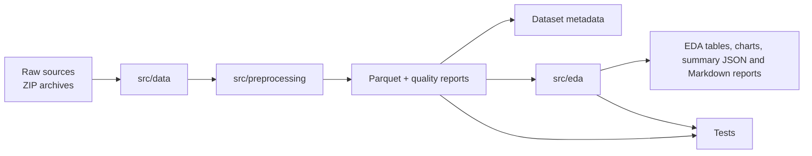

# Technical Architecture

## Purpose

JewelCast AI separates data acquisition, validation, preprocessing, feature
engineering, forecasting, evaluation, inventory optimization, explainability and
presentation. Each layer is independently testable and the dashboard will read
only persisted artefacts.

## Implemented layers (M0–M2)

### `src/data`

| Module | Responsibility |
|---|---|
| `schema.py` | Unified column contract, dtype coercion, validation. |
| `synthetic.py` | Reproducible synthetic jewellery sales, inventory, POs. |
| `festivals.py` | Configurable Indian festival/wedding calendar; UK holiday flags. |
| `uci_loader.py` | Excel ingestion, audit flags, jewellery classification, SKU-day aggregation. |
| `m5_loader.py` | Bounded wide→long conversion, calendar/price joins, hierarchy preservation. |
| `metadata.py` | SHA-256 hashes, sizes, row counts, schemas, provenance. |

### `src/preprocessing`

| Module | Responsibility |
|---|---|
| `clean.py` | Duplicate aggregation, continuous date completion, dtype coercion. |
| `quality.py` | Missingness, duplicates, zero-sales, intermittent demand, outliers. |
| `pipeline.py` | Per-mode orchestration and artefact writing. |

### `src/eda`

| Module | Responsibility |
|---|---|
| `loading.py` | Read processed SKU-day Parquet files, apply optional SKU subsets and exclude UCI non-product audit codes by default. |
| `metrics.py` | Pure descriptive metrics: overview, coverage, trends, SKU statistics, ABC, intermittent demand, concentration, category/seasonality, calendar events, pricing, promotions and synthetic inventory. |
| `plotting.py` | Matplotlib PNG and Plotly HTML charts for trends, categories, ABC, demand classes, pricing, promotions, events and inventory. |
| `report.py` | Compute the full EDA context, export CSV tables, `summary.json` and a human-readable `EDA_REPORT.md`. |
| `pipeline.py` | Per-mode orchestration and result object. |

### `src/utils`

| Module | Responsibility |
|---|---|
| `config.py` | YAML loading, dotted-key access, directory creation. |
| `paths.py` | Repository-root-relative path resolution. |
| `logging.py` | Console + file logging. |
| `io.py` | Hashing, Parquet I/O, JSON serialisation. |

## Data flow

1. Archives are placed in the repository root and extracted to `data/raw/` by
   `scripts/download_data.py` (never downloaded automatically).
2. A mode is selected (`synthetic`, `uci`, `m5`) and built through
   `src/preprocessing/pipeline.py`.
3. Source-specific loaders produce a unified daily frame plus an audit trail.
4. `clean_daily` aggregates duplicate SKU-days, completes each SKU's calendar,
   forward-fills prices/attributes, and preserves null inventory.
5. Quality reports and dataset summaries are written next to the Parquet files.
6. `dataset_metadata.json` records hashes, row counts, schemas and provenance.
7. `scripts/run_eda.py` reads one mode at a time and writes EDA tables, charts,
   `summary.json`, `EDA_REPORT.md` and a top-level manifest under `reports/eda/`.
   Modes are never combined and no forecasting features are created.

## Unified schema

Required: `date, sku, product_name, category, units_sold, selling_price,
discount_percentage, revenue, festival_flag, promotion_flag, available_stock,
data_source`.

Optional: `festival_name, stockout_flag, event_name, date_imputed`.

Key invariant: **unknown inventory is null, never zero**. UCI and M5 have no
inventory records; synthetic inventory is simulated.

## Reproducibility

- Synthetic data uses `numpy.random.default_rng(seed)` with seed 42 by default.
- Assumptions are persisted in `data/synthetic/synthetic_config.json`.
- Processed outputs are Parquet; metadata stores SHA-256 hashes.
- Tests use fixed seeds and temporary directories.

## Planned layers (M3–M7)

| Layer | Planned modules |
|---|---|
| Features | `src/features/` leakage-safe lags, rolling windows, calendar/commercial features, chronological splits. |
| Models | `src/models/` baselines, SARIMA, LightGBM, XGBoost, optional LSTM/GRU, persistence. |
| Forecasting | `src/forecasting/` direct multi-horizon prediction, cold start, quantiles. |
| Evaluation | `src/evaluation/` metrics, rolling-origin backtests, reports. |
| Inventory | `src/inventory/` reorder point, safety stock, inventory position, order quantity, risk. |
| Explainability | `src/explainability/` SHAP and narratives. |
| Scenarios | `src/scenarios/` what-if simulation. |
| Dashboard | `dashboard/` six Streamlit pages. |

## Testing strategy

- Unit tests for jewellery classification, cleaning, date completion, schema
  validation, duplicate aggregation and null-inventory semantics.
- Fixture-based tests for UCI (small Excel workbook) and M5 (small CSV set).
- Reproducibility test for the synthetic generator.
- Unit tests for EDA overview, ABC boundaries, intermittent-demand thresholds,
  missing-data coverage, concentration, category, pricing, promotion, calendar
  and inventory calculations.
- Integration tests for built artefacts and metadata hashes.
