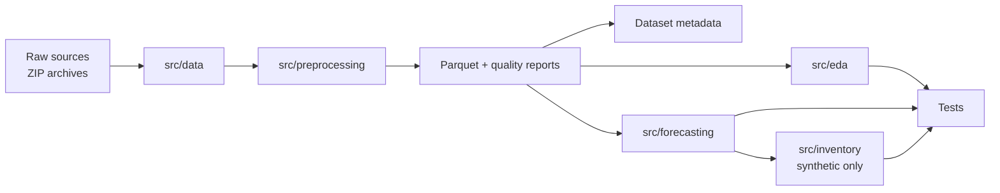

# Technical Architecture

## Purpose

JewelCast AI separates data acquisition, validation, preprocessing, feature
engineering, forecasting, evaluation, inventory optimization, explainability and
presentation. Each layer is independently testable and the dashboard will read
only persisted artefacts.

## Implemented layers (M0–M4)

### `src/data`

| Module | Responsibility |
|---|---|
| `schema.py` | Unified column contract, dtype coercion, validation. |
| `synthetic.py` | Reproducible synthetic jewellery sales, inventory, POs. |
| `festivals.py` | Configurable Indian festival/wedding calendar; UK holiday flags. |
| `uci_loader.py` | Excel ingestion, audit flags, jewellery classification, SKU-day aggregation. |
| `m5_loader.py` | Bounded wide→long conversion, calendar/price joins, hierarchy preservation. |
| `metadata.py` | SHA-256 hashes, sizes, row counts, schemas, provenance. |

### `src/preprocessing`

| Module | Responsibility |
|---|---|
| `clean.py` | Duplicate aggregation, continuous date completion, dtype coercion. |
| `quality.py` | Missingness, duplicates, zero-sales, intermittent demand, outliers. |
| `pipeline.py` | Per-mode orchestration and artefact writing. |

### `src/eda`

| Module | Responsibility |
|---|---|
| `loading.py` | Read processed SKU-day Parquet files, apply optional SKU subsets and exclude UCI non-product audit codes by default. |
| `metrics.py` | Pure descriptive metrics: overview, coverage, trends, SKU statistics, ABC, intermittent demand, concentration, category/seasonality, calendar events, pricing, promotions and synthetic inventory. |
| `plotting.py` | Matplotlib PNG and Plotly HTML charts for trends, categories, ABC, demand classes, pricing, promotions, events and inventory. |
| `report.py` | Compute the full EDA context, export CSV tables, `summary.json` and a human-readable `EDA_REPORT.md`. |
| `pipeline.py` | Per-mode orchestration and result object. |

### `src/forecasting` (implemented in M3)

| Module | Responsibility |
|---|---|
| `data_builder.py` | Leakage-safe daily panels per mode, mode-specific event calendars, calendar gap completion. |
| `feature_engineering.py` | Lag, rolling, calendar, product and price/promotion features; feature selection. |
| `baselines.py` | Naive, seasonal naive and moving-average baselines with fallbacks. |
| `models.py` | Global LightGBM/XGBoost/HistGradientBoosting model wrapper, target transform, persistence. |
| `validation.py` | Chronological splits and rolling-origin backtest origins. |
| `evaluation.py` | MAE, RMSE, WAPE, sMAPE, aggregation and model comparison. |
| `forecasting.py` | Recursive multi-horizon forecasting and pipeline orchestration. |
| `reporting.py` | Forecast artefact writing and Markdown reports. |

### `src/inventory` (implemented in M4, synthetic only)

| Module | Responsibility |
|---|---|
| `settings.py` | Merged inventory configuration with documented defaults. |
| `data_builder.py` | Synthetic daily stock and purchase-order alignment, de-duplication, pending-PO sums, per-SKU inventory state and lead times. |
| `inventory_position.py` | Inventory-position arithmetic and pending incoming-stock helpers. |
| `lead_time.py` | Lead-time and protection-period demand from the daily forecast sequence, with flagged fallbacks. |
| `safety_stock.py` | z-service-factor safety stock, demand-volatility/forecast-error/empirical methods and category fallbacks. |
| `reorder_point.py` | Reorder point, reorder requirement and status classification. |
| `replenishment.py` | Protection period, target stock and constrained non-negative order quantity. |
| `risk_detection.py` | Days of cover, projected stockout dates, stockout/overstock risk rules and explanations. |
| `engine.py` | Shared per-SKU recommendation pipeline used by reports, scenarios and simulation. |
| `forecasting_adapter.py` | Causal adapters from M3 forecasts, saved models and forecast artefacts to inventory decisions. |
| `simulation.py` | Historical inventory simulation with no look-ahead and controlled policy comparison. |
| `evaluation.py` | Service level, fill rate, stockout frequency, lost-sales proxy, inventory cover/turnover and policy comparison. |
| `scenarios.py` | One-assumption-at-a-time model-based scenario analysis. |
| `reporting.py` | Parquet/CSV/JSON/Markdown inventory, scenario, simulation and evaluation outputs. |

### `src/utils`

| Module | Responsibility |
|---|---|
| `config.py` | YAML loading, dotted-key access, directory creation. |
| `paths.py` | Repository-root-relative path resolution. |
| `logging.py` | Console + file logging. |
| `io.py` | Hashing, Parquet I/O, JSON serialisation. |

## Data flow

1. Archives are placed in the repository root and extracted to `data/raw/` by
   `scripts/download_data.py` (never downloaded automatically).
2. A mode is selected (`synthetic`, `uci`, `m5`) and built through
   `src/preprocessing/pipeline.py`.
3. Source-specific loaders produce a unified daily frame plus an audit trail.
4. `clean_daily` aggregates duplicate SKU-days, completes each SKU's calendar,
   forward-fills prices/attributes, and preserves null inventory.
5. Quality reports and dataset summaries are written next to the Parquet files.
6. `dataset_metadata.json` records hashes, row counts, schemas and provenance.
7. `scripts/run_eda.py` reads one mode at a time and writes EDA tables, charts,
   `summary.json`, `EDA_REPORT.md` and a top-level manifest under `reports/eda/`.
   Modes are never combined and no forecasting features are created.
8. `src/forecasting/` builds leakage-safe features, compares baselines and models,
   runs chronological backtests and writes multi-horizon forecasts under
   `reports/forecasting/<mode>/`.
9. `src/inventory/` (synthetic only) loads daily stock, purchase orders and snapshot
   context; aligns pending purchase orders without double counting; calls a causal
   M3 forecast provider whose origin is `decision_date - 1`; computes inventory
   position, lead-time demand, safety stock, reorder point, target stock, order
   quantity and risk; and writes reports under `reports/inventory/`.
10. `scripts/simulate_inventory.py` steps day-by-day through the historical window,
    receiving orders, deciding on review dates, serving observed demand and tracking
    lost sales for the compared policies. `scripts/evaluate_inventory.py` recomputes
    inventory metrics from the persisted simulation.
11. UCI and M5 never receive inventory records; their forecasting behaviour is
   unchanged.

## Unified schema

Required: `date, sku, product_name, category, units_sold, selling_price,
discount_percentage, revenue, festival_flag, promotion_flag, available_stock,
data_source`.

Optional: `festival_name, stockout_flag, event_name, date_imputed`.

Key invariant: **unknown inventory is null, never zero**. UCI and M5 have no
inventory records; synthetic inventory is simulated.

## Reproducibility

- Synthetic data uses `numpy.random.default_rng(seed)` with seed 42 by default.
- Assumptions are persisted in `data/synthetic/synthetic_config.json`.
- Processed outputs are Parquet; metadata stores SHA-256 hashes.
- Tests use fixed seeds and temporary directories.

## Planned layers (M5+)

| Layer | Planned modules |
|---|---|
| Cold start | `src/forecasting/` attribute/category similarity for new SKUs, quantile forecasts. |
| Explainability | `src/explainability/` SHAP and narratives. |
| Scenarios (app) | Business-facing what-if simulation on top of the implemented inventory scenario engine. |
| Dashboard | `dashboard/` six Streamlit pages reading persisted artefacts. |

## Testing strategy

- Unit tests for jewellery classification, cleaning, date completion, schema
  validation, duplicate aggregation and null-inventory semantics.
- Fixture-based tests for UCI (small Excel workbook) and M5 (small CSV set).
- Reproducibility test for the synthetic generator.
- Unit tests for EDA overview, ABC boundaries, intermittent-demand thresholds,
  missing-data coverage, concentration, category, pricing, promotion, calendar
  and inventory calculations.
- Inventory tests for inventory position, purchase-order de-duplication and pending
  sums, variable lead times, lead-time/protection demand, safety stock, reorder
  point, target stock, MOQ/multiples/capacity, days of cover, stockout/overstock
  risk, missing inventory/forecast data, simulation order arrival, metric formulas,
  forecast origins, scenarios and report schemas.
- Integration tests for built artefacts and metadata hashes.
